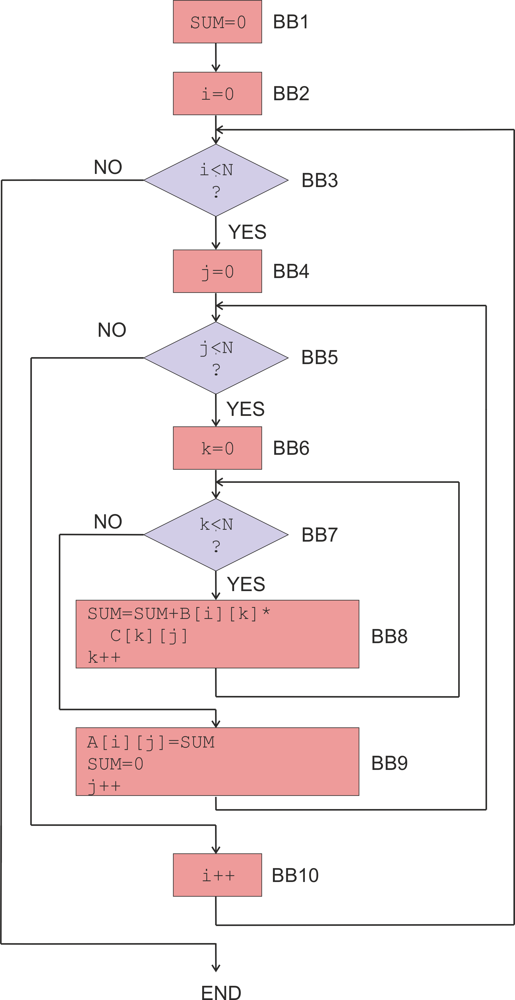

# System Metrics & Characterization

## Goals of the Lab Session

In supercomputing systems, measuring system metrics and characterizing program behavior are essential for understanding, evaluating, and optimizing computational performance. These are the main goals of the lab:

- Set up the working environment.

- Learn basic system metrics.

- Obtain and report system metrics given a problem/exercise description.

- Obtain and report system metrics using profiling tools.

## Outline

- [Lab Environment](#lab-environment)

- [Part I: Metric Definitions](#part-i-metric-definitions)

- [Part II: Written Exercise](#part-ii-written-exercise) (includes deliverable)

- [Part III: Profiling Tools](#part-iii-profiling-tools) (includes deliverable)

- [Appendix A: Shell Basics](#appendix-a-shell-basics)

- [Appendix B: Compiler Basics](#appendix-b-compiler-basics)

- [Appendix C: Debugger Basics](#appendix-c-debugger-basics)

- [Final Notes](#final-notes)

## Lab Environment

Part III (and appendices) will be conducted remotely connecting through the Secure Shell protocol (ssh) to the educational server lab000.cps.unizar.es.

Conneting to all the educational servers (including lab000, clinic, hendrix, pilgor, etc.) can be done using your institutional credentials (e.g., username a123456 and your administrative password). Consider the following depending on your previous experience on these servers:

- Those who have never used any of these servers before follow this [link](https://webdiis.unizar.es/cgi-bin/hendrix-pw) to create a new account.
  
- Those who have already an account but do not remember the password, or simply have never used these services, follow this [link](https://webdiis.unizar.es/cgi-bin/hendrix-newpw) to set up a new password.

- Those who would like to change the type of Shell for the remote machines at the university (bash Shell is more friendly) use this [link](https://webdiis.unizar.es/cgi-bin/hendrix-chsh).

The process to connect remotely to lab000 using ssh varies depending on the local Operating System (OS):

- UNIX/Linux/macOS: open a Shell terminal and run this command:

```
$> ssh -X username@lab000.cps.unizar.es
```
Symbol `$>` refers to the prompt of the Shell and should not be included in the command-line order. The option `-X` enables X11 forwarding (it allows graphical applications running on the remote machine to display their windows on your local machine).

- Windows: there exist many applications to perform the ssh connection such as PuTTY+Xming, MobaXTerm, WinSCP, Termius, etc. Some of them (e.g., MobaXTerm) include a GUI interface to copy files from the local machine to the server and vice versa. For example, refer to this [document](http://webdiis.unizar.es/asignaturas/PROG1/doc/anuncios/programar_en_hendrix_desde_casa.pdf) to configure PuTTY+Xming.

Finally, there are many text editors to code C/C++ programs like vi, vim, or nano to write programs directly from the Shell without the need for windows. Choose your preferred option to navigate and edit code, but be aware that other heavy-weighted editors (e.g., VSCodium) may consume all your disk quota in the server.

## Part I: Metric Definitions

System metrics help quantify how efficiently computing resources are being used. Program characterization (see Part III) complements these measurements by identifying computational bottlenecks, memory-management issues, and hardware-related inefficiencies.

Together, these analyses enable researchers and system administrators to compare architectures, evaluate optimization techniques, improve resource utilization, and reduce energy consumption. Accurate and reproducible measurements are also crucial for reporting results, validating performance claims, and ensuring fair comparisons between different implementations and computing systems. The following is a list of key system metrics:

- Execution time ($$T_{exec}$$): the time required by a computer to execute a given program or workload, from start to completion.

- Performance: the amount of useful work completed per unit of time. For a fixed workload, it is commonly defined as:

$$
\text{Performance} = \frac{1}{T_{Exec}}
$$

- Clock rate (operating frequency): the number of clock cycles generated per second, measured in Hz. For example, 2.5 GHz = 2.5 × 10⁹ cycles/s.

- Cycle time: the duration of one clock cycle. It is the inverse of the clock rate:

$$
\text{Cycle time} = \frac{1}{\text{Clock rate}}
$$

- Clock cycles: the number of processor clock periods required to execute a workload:

$$
\text{Clock cycles} = \frac{T_{Exec}}{\text{Cycle time}}
$$

- Instructions count (IC): the total number of machine-level instructions executed by a program/workload.

- Cycles Per Instruction (CPI): the average number of clock cycles required to execute one instruction:

$$
\text{CPI} = \frac{\text{Clock cycles}}{\text{IC}}
$$

- Instructions Per Second (IPS): the number of instructions executed per second (instruction throughput):

$$
\text{IPS} = \frac{\text{IC}}{T_{Exec}} = \frac{\text{Clock rate}}{\text{CPI}} 
$$  

- Data bandwidth (dBW): the rate at which data are transferred or processed, typically measured in bytes/s. The precise definition depends on the system and workload. In this course, we will assume the following equation, where OC is the Operand Count measured as the number of memory (load and store) instructions of a program, considering that a given memory instruction transferres a single operand.

$$
\text{dBW} = \frac{\text{OC} \times \frac{\text{bytes}}{\text{operand}}}{T_{Exec}}
$$ 

- Instruction bandwidth (iBW): the rate at which instructions are transferred, typically measured in bytes/s.

$$
\text{iBW} = \frac{\text{IC} \times \frac{\text{bytes}}{\text{instruction}}}{T_{Exec}}
$$   

- Floating-Point Operations (FLOP): the number of individual floating-point arithmetic operations performed by a workload, e.g., additions and multiplications. FLOP is an operation count (quantity of operations), not a rate.

- FLOP per Second (FLOPS): the rate at which floating-point operations are performed (floating-point throughput):

$$
\text{FLOPS} = \frac{\text{FLOP}}{T_{Exec}}
$$

- Energy Per Instruction (EPI): the average energy consumed to execute one instruction, typically measured in Joules/instruction:

$$
\text{EPI} = \frac{\text{Energy}}{\text{IC}}
$$

- Energy Per FLOP (EPF): the average energy consumed per floating-point operation, typically measured in Joules/FLOP:

$$
\text{EPF} = \frac{\text{Energy}}{\text{FLOP}}
$$

- Performance to power ratio (Computing efficiency): the amount of computational performance obtained per unit of power, commonly expressed as FLOPS/W. Higher values indicate more computation for the same power consumption:

$$
\text{Computing efficiency} = \frac{\text{FLOPS}}{\text{Power}}
$$

A useful way to see how the metrics connect is:

$$
T_{Exec} = \frac{\text{Clock cycles}}{\text{Clock rate}}
$$

$$
\text{Clock cycles} = \text{IC} \times \text{CPI}
$$

Therefore, the Iron Law expresses the execution time as:

$$
T_{exec} = \frac{\text{IC} \times \text{CPI}}{\text{Clock rate}}
$$

The above rates are usually reported using decimal prefixes: Kilo (K) = $$10^3$$, Mega (M) = $$10^6$$, Giga (G) = $$10^9$$, or Tera (T) = $$10^{12}$$. Conversely, other metrics are usually reported using milli (m) = $$10^{-3}$$, micro (u) = $$10^{-6}$$, nano (n) = $$10^{-9}$$, or pico (p) = $$10^{-12}$$ prefixes.

Finally, the aforementioned metrics, specifically those reporting time (either in seconds or cycles), can be used to calculate the speedup (Sup). The speedup measures how much faster one implementation or system executes a workload compared with a reference implementation:

$$
Sup = \frac{T_{exec,reference}}{T_{exec,optimized}}
$$

For example, Sup = 2 means the optimized version is 2× faster (takes half the time), Sup = 1 means no improvement, and Sup < 1 means the optimized version is slower than the reference (this is actually a slowdown).

## Part II: Written Exercise

**The following exercise should be delivered through the corresponding Moodle resource before the stated deadline. The uploaded file should be in PDF format. Scanned handwritten files are accepted. This exercise must be completed and submitted individually.**

General Matrix Multiply (GEMM) is a common algorithm in linear algebra, machine learning, statistics, and many other domains. A possible high-level source code for GEMM is as follows:

   ```cpp
   #define N 400

   double SUM = 0;
   double A[N][N];
   double B[N][N];
   double C[N][N];

   for (int i = 0; i < N; i++) {
      for (int j = 0; j < N; j++) {
      	 for (int k = 0; k < N; k++) {
         	SUM = SUM + B[i][k] * C[k][j];
		 }
        A[i][j] = SUM;
		 SUM = 0;
      }
   }
   ```

A possible machine language compilation scheme is as follows:

<p align="left">
  
</p>


BB stands for Basic Block of instructions. The following table summarizes the total number of instructions and the subset of memory instructions for every basic block:

| Basic block | Instructions | Mem. instrs |
|:----------:|:----------:|:----------:|
| BB1    |  1        | 0         |
| BB2    |  1        | 0         |
| BB3    |  1        | 0         |
| BB4    |  1        | 0         |
| BB5    |  1        | 0         |
| BB6    |  1        | 0         |
| BB7    |  1        | 0         |
| BB8    |  7        | 3         |
| BB9    |  4        | 1         |
| BB10   |  2        | 0         |

Assume that machine language instructions are of a fixed size and occupy 4 bytes, whereas floating-point values are double-precision and occupy 8 bytes each. When executing this program, a compute speed of 4 GFLOPS and a power of 100 W are measured. The following metrics are requested, choosing the appropriate units so that the number of digits is small.

a)	FLOP.

b)	Execution time.

c)	IPS.

d)	iBW (iBytes/s).

e)	dBW (dBytes/s).

f)	EPF.

## Part III: Profiling Tools

Let's take two different versions of the GEMM algorithm to learn how to use profiling tools. The src folder of the repository contains the files gemm-naive.cpp and gemm-eigen.cpp. The former code implements a naive three-nested loop (very similar to the code snippet in Part II), whereas the latter code employs the [C++ Eigen math library](https://libeigen.gitlab.io/eigen/docs-nightly/). Analyze the three main functions in the source codes and notice not only the difference in the programming effort but also the fact that both versions take as input the problem size (matrix dimensions) from the command line (see [Appendix A](#appendix-a-shell-basics)).

Transfer these two files and the Eigen 3.4.0 package version to the server lab000 using the scp command under Linux (again see [Appendix A](#appendix-a-shell-basics)) or a GUI interface under Windows. Then, unzip the Eigen library and be patient (it may take some time):

```
$> tar -xzvf eigen-3.4.0.tar.gz
```

This library is a headers-only Eigen implementation, meaning that the library compiles with the application, so just refer to the directory where the Eigen library is to be found when compiling gemm-eigen.cpp with the flag -I:

```
$> g++ -O2 -pg -Wall -I <path-to>/eigen-3.4.0/ gemm-eigen.cpp -o gemm-eigen
```

Compile as well the naive version using the flags -O2 (compilation optimization level), -pg (compilation with profiling instrumentation), and -Wall (enables common compiler warnings), but not the option -I as the naive version does not employ the math library.

Try some runs for both GEMM versions. Remember that both programs expect the problem size (N) as an input parameter in the command line.

The next subsections introduce different profiling tools to perform an advanced characterization of applications: Gprof, Perf, and Valgrind.

### Gprof: Where does my program spend its execution time?

GNU Gprof is a source-level, function-oriented profiler for programs compiled with GCC/G++. It provides information about how the execution time of a program is distributed among its functions and how functions call each other. In other words, Gprof provides a high-level characterization of the program based on its function structure. It identifies which parts of the application dominate execution time, particularly when the program has relatively simple function boundaries, helping us locate potential computational bottlenecks before investigating the underlying hardware behavior.

How Gprof works? First, the program should be compiled with profiling instrumentation. That is, adding the flag -pg as mentioned above. Second, a profiling data file (gmon.out) is generated after running the program. Finally, gmon.out can be analyzed with:

```
$> gprof <my-program> gmon.out
```
Where \<my-program\> is the binary file after compiling the program.

The output basically shows the time spent in every function, the number of calls to every function, and the function call tree of the program.

**Exercise 1: Profile both gemm-naive and gemm-eigen programs using Gprof. Make sure the problem size (N) is large enough (e.g., N=500) that gemm() runs for a reasonably long time. Otherwise, the sampling-based timing information can be too coarse to produce an informative profile. Particularly, report the relative time spent in every function over the total execution time in the case of gemm-naive and discuss the obtained results. In the case of gemm-eigen, discuss why the output is so difficult to interpret.**

### Perf: How efficiently is the hardware executing the program?

Perf is an event-based, command-line profiling tool for Linux that uses hardware performance event counters to measure a number of specific kinds of events that occur during the execution of a program. Examples of events include processor clock cycles, retired instructions, data cache hits, or data cache misses. The specific events to be measured are determined by the profile configuration that is used to set up data collection. Particularly, Perf provides access to the Performance Monitoring Unit (PMU) in a CPU, and thus allows the user to have a close look at the behavior of the hardware and its associated events. The available events are processor-implementation specific. In addition, Perf can also monitor software events through pure-kernel counters, such as context switches or minor faults, and create reports out of the data that are collected.

To obtain a full list of the supported events, type:

```
$> perf list
```

Press ENTER to scroll down in the list of events and `q` to exit.

To filter the list just showing a list of events available in a specific category, use `perf list` followed by the category name: `hw`, `sw`, `cache`, `pmu`, etcetera. For instance, `perf list sw` displays the list of software pre-defined events in Linux.

With the `stat` option and no particular events specified in the command line, `perf` runs a command and collects by default some common performance statistics during the execution of such a command, which will be enough for our purpose. For example:

```
$> perf stat ls
```

The displayed stats indicate the following:

* `task-clock (msec)`: the amount of time that the command execution spent in the CPU (in milliseconds).
* `context-switches`: this stat (also known as process switches) indicates the number of times the CPUs were switched from one process (or thread) to another.
* `cpu-migrations`: in a multicore machine, CPU or process migrations happen as a standard part of the process scheduling, and it is relatively easy to migrate a process within a given machine, since most resources do not need to be changed but only the execution context (primarily the program counter and the registers).
* `page-faults`: refers to the number of page fault exceptions raised by the computer hardware when the running program accesses a memory page that is not currently mapped in the physical memory by the memory management unit.
* `cycles`: the total number of CPU clock cycles that are consumed.
* `stalled-cycles-frontend`: measures the number of CPU clock cycles during which the instruction-fetch/decode front end is stalled, preventing the back end from receiving enough instructions to execute.
* `instructions`: the total number of CPU instructions that are executed.
* `branches`: the total number of instruction branches encountered while executing the program. This is the CPU-level representation of decision points and loops in the code. The more branches, the lower the performance.
* `branch-misses`: to compensate for the above performance penalties, modern CPUs attempt to predict the flow the code will take. This stat indicates the number of branch misses and the percentage with respect to the overall number of branches.
* `seconds time elapsed`: refers to the overall execution time of the command. Dividing the first stat with the current stat gives the percentage of CPU utilization.

Note that other metrics like the operating frequency (in GHz) or the instructions per cycle (IPC) can be derived from the previous stats.

The `-e` option can be used to collect just specific events, which are separated with commas:

```
$> perf stat -e cycles,instructions ls
```

The above example just shows the cycles and instructions for the `ls` run.

It is also possible to use `perf stat` to run the same test workload multiple times and get the standard deviation from the mean. To do so, use the `-r` option as follows:

```
$> perf stat -r 5 ls
```

In the previous example, `ls` is run 5 times and the mean count for each event, along with a ratio of std-dev/mean is printed.

Perf can be configured not only to measure performance but also energy consumption. On Linux systems with Intel RAPL support (the case of lab000), perf stat can be used with the RAPL energy events:

```
$> perf stat -e power/energy-pkg/ ls
```
In this case, pkg refers to energy consumed by the CPU package during the execution of the program, typically in Joules.

**Exercise 2: Plot the speedup (Sup) of the gemm-eigen version vs. the gemm-naive version as a function of the problem size, as well as the raw package energy consumption (in Joules) of both versions as a function of the problem size. Specifically, vary N from 100 to 1000 in steps of 100 and report average execution time and energy for 5 runs. Use the most appropriate perf command to minimize the number of command launches. Overall, three graph lines are requested: speedup, gemm-naive energy, and gemm-eigen energy. Consider plotting a single graph with two Y-axes (execution time and energy). Discuss the obtained results.**

### Valgrind: Is my program using memory correctly?

Valgrind is a suite of tools for dynamic analysis of programs, primarily used to detect and diagnose problems related to memory management and memory accesses during program execution. Its most commonly used component, Memcheck, can detect issues such as memory leaks (dynamically allocated memory that is not properly released), invalid memory accesses (reading from or writing to memory outside an allocated region), use of uninitialized memory (using values that have not been properly initialized), or incorrect memory deallocation (e.g., mismatching new/delete and new[]/delete[]).

The following command invokes Valgrind's Memcheck tool and performs a detailed analysis of the dynamically allocated memory by \<my-program\>. Specifically, the output of this command is a detailed report of detected memory leaks, including information about where the leaked memory was allocated:

```
valgrind --leak-check=full <my-program>
```
**Exercise 3: Run Valgrind's Memcheck for gemm-naive with N=500 and interpret the different memory leaks (direct and indirect). Then, modify the source code to address such leaks, recompile the program, rerun the same command, and verify that all the memory leaks have been fixed. Finally, run the command for gemm-eigen with N=500 and compare the results with the naive implementation. Overall, the report should contain: i) a description of the different memory leaks, including a reason about the specific number of leaked bytes and what memory allocations cause the problem, ii) the added code lines that fix the problem, and iii) a justification of the results obtained for gemm-eigen.**

**All the obtained results and discussions across exercises 1 to 3 should be delivered as a 3-page single-column report through the corresponding Moodle resource before the stated deadline. The uploaded file should be in PDF format. These exercises are encouraged to be completed and submitted in couples. Just a member of the couple submits the report through Moodle (both names must appear in the report).**

## Appendix A: Shell Basics

A Shell or command line interpreter is a user interface that is navigated by typing commands at prompts (requests for input). Unlike a Graphical User Interface (GUI) OS, a Shell only uses a keyboard to navigate by entering commands and does not utilize a mouse for navigating. Although using a Shell requires to remember many different commands, it can be a valuable resource and should not be ignored. Using a Shell, you can perform almost all the same tasks that can be done with a GUI. However, many tasks can be performed quicker with powerful commands and can be easier to automate (through the execution of batch files or scripts) and do remotely.

Extended information and usage for every command can be obtained by typing: `man command_name`

The next subsections summarize basic commands about the management of files, directories, synchronous/asynchronous execution, standard input/output (I/O), processes, and so on.

### Autocomplete function

Autocomplete is a useful function to speed up the writing of a command line. Press TAB at any time while writing a command to experience the effect. If the function does not seem to work, type the command `set +u` and try again.

### Files (Namespace)

- Path of the current directory: `pwd`
- Change current directory to dirname: `cd dirname`
- Change to home directory: `cd`, `cd $HOME`
- Change to root directory: `cd /`
- Change to parent directory: `cd ..`
- Change to current directory: `cd .`
- Listing contents of a directory: `ls dirname` (empty dirname refers to the current directory)
- Absolute and relative paths

#### Examples (try each command as a sorted list and check out the effect of each of them. Alternatively, you can add other commands in between and check out their effects as well)

```
01. pwd
02. ls
03. cd / 
04. ls 
05. cd proc
06. ls
07. pwd
08. cd
09. pwd
10. cd ..
11. ls
12. cd /home/username/Desktop
13. pwd
14. cd /proc
15. cd ../home/username/Desktop
16. pwd
```
Commands #12 and #15 refer to the same directory. The difference lies in that the former uses an absolute path from "/" to reach the directory destination (no matter what the current directory is), whereas the latter uses a relative path from the current directory (/proc) to reach the destination.

Download the apd-materials.tar.gz file from the src folder in the GitHub repository and transfer it to your home directory in the server. To do so, open a Shell in the local machine, change the directory to the location of the downloaded file, and type the following command:

```
$> scp apd-materials.zip username@lab000.cps.unizar.es:/home/username
```

Then, on the server side, unzip the file using the command:

```
$> unzip apd-materials.zip
```

### Directories (Create, Remove, Listing)

- Creation of new directories: `mkdir`
- Removal of directories: `rmdir`
- Listing hidden files: `ls –a`
- Listing extended information: `ls –l`

#### Examples

```
01. cd
02. cd SC
02. mkdir trash
03. mkdir dir1 dir2 dir3
04. ls -l
05. cd trash
06. pwd
07. cd ..
08. pwd
09. rmdir trash
10. ls dir1
11. ls –a
12. ls –a dir1
```

### Files (Copy, Move, Listing Contents)
	
- Copying files: `cp`
- Moving/changing name of files: `mv`
- Removal of files: `rm`
- Listing contents of files: `more`, `cat`
- Editing files: `vi`, `vim`, `emacs`, `gedit`, `nano` (and many others...)

#### Examples

```
01. cd
02. cp /home/username/SC/lab01/HelloWorld.cpp .
03. ls
04. cp SC/lab01/HelloWorld.cpp another.cpp
05. ls
06. mv another.cpp program.cpp
07. ls
08. mv program.cpp SC/dir1
09. ls
10. cd SC/dir1
11. ls
12. rm program.cpp
13. cd ..
14. rmdir dir1
15. ls
16. cp lab01/HelloWorld.cpp dir2
17. more lab01/HelloWorld.cpp
18. more dir2/HelloWorld.cpp
```

### Synchronous/Asynchronous Execution

Synchronous execution (step by step):

- Shell waits for a command.
- Shell launches the command to be executed.
- Shell waits for the execution to finish.
- Shell waits for a new command.

#### Example

```
$> gedit new.cpp
```

Asynchronous execution (step by step):

- Shell waits for a command.
- Shell launches the command to be executed.
- Shell does not wait for the execution to finish and immediately waits for a new command that can be launched while the previous one is still running.

#### Example

```
$> gedit new.cpp &
```

### Standard I/O

Every command/process launched by the Shell has three communication ways:

- Standard input: the process reads from the keyboard.
- Standard output: the process writes to the screen.
- Standard error output: the process writes error messages through an alternate way to the screen.

The above behavior can be changed from the Shell with alternate forwarding options as follows:

- prog > f: forwards the standard output of the prog command to the f file. The file is shorten if already exists and created if the file does not exist.
- prog >> f: forwards the standard output of the prog command to the f file, preserving the original content of f and adding the new content at the end of the file.
- prog < f: forwards the standard input to f. The file must exist.
- prog 2> f : forwards the standard error output to f. The file is shorten if already exists and created if the file does not exist.
- prog1 | prog2: forwards the standard output of prog1 to the standard input of prog2.

#### Examples

```
01. cd $HOME/SC/lab01 
02. ls –l > trash
03. more trash
04. cat < trash
05. cat < trash > trash2
06. more trash2
07. cat < trash >> trash2
08. more trash2
09. cat < trash | wc
10. man wc
11. rm trash trash2
```

### Parameter Passing in C++

The main() routine of a C++ program can receive the following parameters: `argc` (argument count) and `argv` (argument vector).

```
int main (int argc, char *argv[]) { /* ... */ }
```

The Shell initializes these variables and they can be used later on by the program. The argc parameter contains the number of arguments (words) in the command line that launched the program, whereas argv is an array of character pointers listing all the arguments. For instance, for the following command line:

```
$> ./myprogram hey you 6
```
The Shell sets argc=4, argv[0]="myprogram" (i.e., the name of the program), argv[1]="hey", argv[2]="you", and argv[3]="6". Note that argv[3] is a char, not an integer.

### Processes (Information and Removal)

- Information about processes: `ps`
- Information about user processes: `ps –u username`
- Extended information about user processes: `ps –lu username`
- Remove/killing a process: `kill -9 PID`, where PID refers to the process id, and can be retrieved from the output of the above command
		
#### Examples

```
01. ps
02. ps –u username
03. ps –lu username
04. man ps
05. kill -9 PID
```

Finally, you are encouraged to check out these games from [OverTheWire](https://overthewire.org/wargames/bandit/) and [MIT](https://web.mit.edu/mprat/Public/web/Terminus/Web/main.html) to learn more command line skills.

## Appendix B: Compiler Basics

Compilation tools help the programmer in the process of generating the binary (machine code) corresponding to the program to be implemented. When we think of compilation tools we should not limit ourselves to the compiler alone. We must add to the list debuggers and program behavior analyzers (performance, code, memory, parallelism...). These tools help the programmer to obtain a correct, safe, and efficient binary.

The compiler is a tool capable of translating a program written in high level (C, C ++, Ada, Pascal...) to machine or binary code that can be executed on the target processor (x86, x64, SPARC V9...).

Once the program of the application that we want to implement has been coded in a high-level language, we save it in a text file, which we will call a source file. The generation of a binary (executable file) from a source file in a high-level language requires two compilation phases: translation (transfer) and linking (link). In the first phase, the compiler analyzes the source file in high-level language and generates an equivalent program in native machine language of the processor architecture in which we want to execute the program. As a result, the translation phase generates an object file. To finish building a binary file of the complete program, all those functions and procedures that are used but whose implementation can be found in other object files (system library or user library) are required. In the linking phase, the objects (or a reference to them) containing the external functions and procedures (system or user) used by the original source are added.

The programs that we write in C++ language must be stored in a simple text file whose extension will be ".cpp". The default extension of the object files will be ".o". In lab000, we have the GNU g++ compiler for programs written in C++ language. This tool does the compilation phases, translation and linking, in a joint or separate manner.

To perform only the translation, use the `–c` flag:

```
$> g++ -Wall -c sourcecode.cpp
```
The `-Wall` flag enables all the warning messages from the compiler during the compilation process. It is encouraged to include such a flag in all compilations. On a successful translation, a sourcecode.o file is produced as a result. This file refers to the object file of the source file sourcecode.cpp. Try such a command with the HelloWorld.cpp example.

If we want to carry out the linking of several object files to generate the executable (named "binary_file" in the command below), we should use the `-o` flag. Only one of the object files should have the main symbol defined, which will be the entry point to the program. Those objects belonging to system libraries do not need to be specified as they are automatically added by the compiler:

```
$> g++ -Wall object0.o object1.o object2.o ... objectN-1.o -o binary_file
```

Try the above command using the HelloWorld2.cpp and func.cpp source files. Remember that the corresponding object files should be generated first.

Finally, if we want to generate the executable file corresponding to the source file in a single step, use the `–o` flag:

```
$> g++ -Wall source0.cpp source1.cpp ... sourceN-1.cpp -o binary_file
```

If the `-o` flag is not specified, an executable named "a.out" will be generated by default. Furthermore, this command allows specifying object files as input to the compilation tool.

With the `-v` flag specified in the compilation command, verbose information on all the steps the tool takes while compiling a source file is displayed. In addition to these options, compilers have many other available options. Type the following command for further information:

```
$> man g++
```

Once the executable file of our program has been generated, we can launch it from the command line itself using:

```
$> ./binary_file
```

Food for thought: why could be of interest to separate the translation and linking phases during compilation?

## Appendix C: Debugger Basics

A debugger is an application for finding out how a program runs or for analyzing the moment a program crashes. Debuggers usually perform many useful tasks, including running the program, stopping the program under specific conditions, analyzing the situation, making modifications, and testing new changes.

GDB can be used as a C++ debugger if a program is compiled with the GNU g++ compiler and the `–g` flag is enabled. By debugging with GDB, you can detect errors and solve them before they cause severe issues. The first step of learning how to use GDB for C++ debugging is to compile the C++ code with the `-g` flag:

```
$> g++ -Wall -g sourcecode.cpp –o binary_file
```

The next step is calling GDB to start the debugging process for the program you wish to analyze:

```
$> gdb binary_file
```

Try the above command using the binary after compiling mult.cpp. The above command opens GDB but does not run the program. There are several ways of running the opened program. First, the program can be executed with the run command:

```
(gdb) run
```

Command-line arguments can be passed if the program needs them:

```
(gdb) run arg1 arg2 ... argN-1
```

A program can be debugged more efficiently using breakpoints. Breakpoints refer to instructions that stop the execution at specific code locations. For instance, breakpoints can be set in places suspected to be problematic. It is a common practice to set breakpoints before running the program. Breakpoints can be set in two ways:

- Setting a line at which the execution stops.
- Setting a function name to stop the execution at.

The following example sets a breakpoint at the start of the main function:

```
(gdb) b main
```

This example sets a breakpoint at a specific line (7):

```
(gdb) b 7
```

This example lists all of the breakpoints:

```
(gdb) info b
```

This command deletes the breakpoint at line 7:

```
(gdb) delete 2
```

You might need to execute a program slowly, moving from one line to the next one. There are two ways of making the program run step-by-step.
The command next, or simply n, executes the current command, stops, and displays the next line for execution. However, if the line is a function call, the debugger will fully execute the function before the execution stops again:

```
(gdb) n
```

To execute line after line, even if a new function is invoked so that the sequential program flow breaks, the command step (s) can be used.

The command continue (c) resumes the execution until the end or the next breakpoint:

```
(gdb) c
```

The values of variables can be checked during specific moments of the execution. The print command can be used for this task. It is possible to print more complicated expressions, type casts, call functions, etc.

Syntax for using print:

- print \<exp\>: to get values of expressions.
- print /x \<exp\>: to get the value of expressions in hexadecimal.
- print /t \<exp\>: to get the value of expressions in binary.
- print /d \<exp\>: to get the value of expressions as unsigned int format.
- print /c \<exp\>: to get the value of expressions as signed int format.

Use combinations of the above commands to show how the variables i, j, and v are updated after a few iterations of the innermost loop of mult.cpp.

More commands and further details can be seen typing:

```
(gdb) help
```	

Type the command quit (q) to exit from the gdb environment.

## Final Notes

Feedback to improve this lab or noticing typos is very welcome. Should you have any question about how to submit or elaborate the deliverables, please contact me at: alvabre@unizar.es
